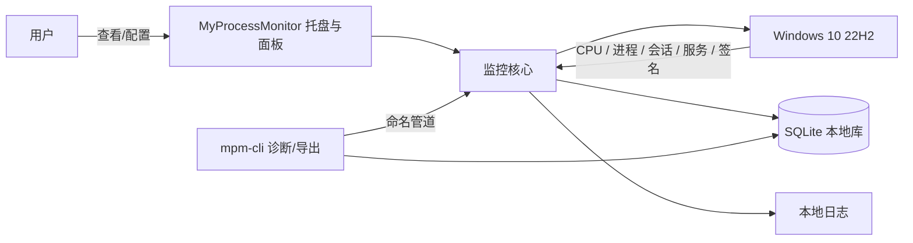
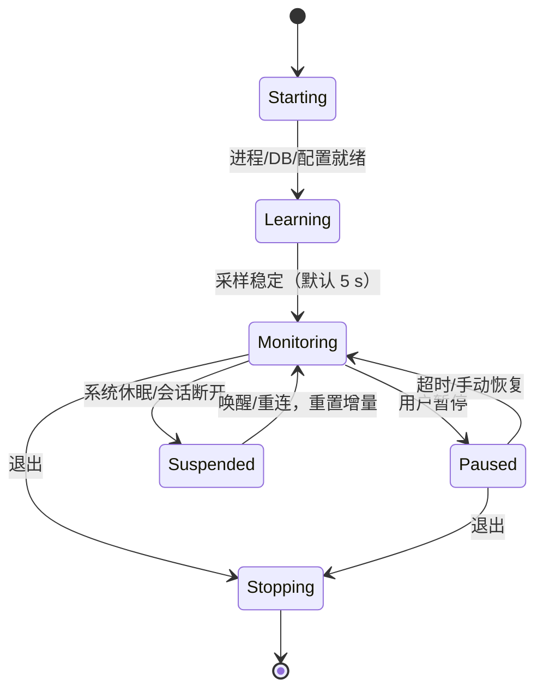
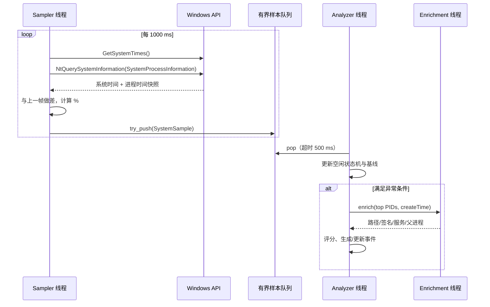

# MyProcessMonitor 架构设计

> 状态：v0.1 已实现（可运行）  
> 日期：2026-10-23  
> 目标平台：Windows 10 22H2（build 19045），x64  
> 编译器：MSVC 19.51.36260（VS 2026 / v14.51 工具集）  
> 语言标准：C++17  
> 构建系统：CMake + Ninja（或 Visual Studio generator）

---

## 0. v0.1 实现快照

本文件最初是架构与依赖设计稿；v0.1 已按下面的范围落地，构建、单元测试与手工运行结果见 [README](../README.md)。

### 0.1 已实现

| 模块 | v0.1 实现 |
|---|---|
| 采样 | `GetSystemTimes` + `NtQuerySystemInformation(SystemProcessInformation)`；NT 失败自动回退 Toolhelp32 + `GetProcessTimes`；QPC 时间基准；PID 0 空闲伪进程不参与归因 |
| 空闲判定 | `GetLastInputInfo`、WTS 连接状态、`OpenInputDesktop`、`SHQueryUserNotificationState`；支持锁屏/息屏作为空闲、全屏/演示抑制 |
| 检测 | 空闲阈值、系统 CPU 触发、最小忙核、持续秒数、退出滞回、全局冷却、启动宽限；前后台进程降分 |
| 归因 | 按镜像名聚合进程组；Top 3 组解析路径/发布者/Authenticode 签名；`svchost.exe` 的 `-s` 服务名映射；已知 Windows 维护任务上限 |
| 存储 | SQLite WAL，单表 `events` 保存事件 JSON；启动时按 `retentionDays` 清理；事件 id 可 upsert |
| UI | 原生 Win32 托盘 + 状态气泡 + 原生 ListView 面板；暂停/恢复、数据目录、退出 |
| CLI | `snapshot`、`watch`、`events`、`doctor` |
| 工程 | CMake targets、Ninja presets、vcpkg manifest、app manifest、9 个 GoogleTest 用例 |

### 0.2 与设计稿的差异 / 暂缓项

| 项目 | v0.1 状态 | 说明 |
|---|---|---|
| Core Audio 媒体检测 | 暂缓 | `ActivityState::mediaPlaying` 恒为 `false`；字段和抑制逻辑已预留 |
| 进程树聚合 | 暂缓 | 已采集 `parentPid`，检测器当前按镜像名聚合；后续加入树根/子进程贡献 |
| 基线学习 | 暂缓 | 评分中的 novelty 固定为 `0.35`；`baselineP95` 字段保留 |
| 冷却粒度 | 全局 | 当前所有组共享 `cooldownSeconds`，不是按组冷却 |
| 导出 | 暂缓 | `events --json` 已可用；Markdown/CSV 导出未实现 |
| 开机自启 | 暂缓 | `startup.autoStart` 已读取但未写注册表/启动目录 |
| 允许列表 | 暂缓 | 已有 known maintenance 标注，未提供用户 allowlist |
| 提权诊断 | 暂缓 | 默认普通用户；受保护进程可能只得到 `access_denied` |
| ETW / 线程级归因 | 不在 v0.1 | 仍属于后续阶段 |

### 0.3 关键实现参数（与设计稿一致或已收紧）

- 采样间隔默认 1000 ms，配置范围 250–10000 ms；
- 空闲阈值默认 120 s，配置下限 10 s；
- 系统 CPU 触发默认 12%，持续默认 30 s；
- 退出阈值默认 6%，退出持续默认 60 s；
- 冷却默认 900 s，启动宽限默认 180 s；
- `sustainSeconds` 配置下限已收紧到 5 s，避免 1 s 级抖动误报；
- 忙核要求：`max(minBusyCores, 0.06 × logicalCpuCount)`；16 核时至少 0.96 核；
- 评分：`35% 系统强度 + 20% 持续 + 20% 主导度 + 15% novelty + 10% 信任因子`，再应用已知维护上限与前台降分。

### 0.4 运行与验证

- 构建目录：`build/msvc-x64-debug` / `build/msvc-x64-release`；
- 单元测试：`ctest --preset msvc-x64-debug --output-on-failure`，当前 9/9 通过；
- 手工验证：`mpm-cli snapshot` 能列出 230+ 进程并解析签名；`watch` 在合成的单核满载进程下成功产生事件并写入 SQLite；托盘可创建、打开面板、正常退出并刷新日志；
- 数据目录：`%LOCALAPPDATA%\MyProcessMonitor`（`config.json`、`data\monitor.db`、`logs\mpm.log`）。

---

## 1. 背景与问题定义

### 1.1 现象

电脑在一段时间没有鼠标、键盘输入后，CPU 占用率明显升高，风扇转速加快。用户离开电脑时，系统可能正在执行：

- Windows Defender 计划扫描、病毒库更新；
- Windows Update 扫描、组件安装、MSI 修复；
- Windows Search 索引、SysMain 预读取；
- .NET / NGEN 后台编译、任务计划程序中的维护任务；
- 浏览器、网盘、Steam、Adobe、显卡驱动等第三方后台更新；
- 恶意程序、挖矿程序、被植入的后台进程；
- 驱动或内核态组件导致的 CPU 消耗（没有对应的用户态进程）。

仅看任务管理器很难回答三个关键问题：

1. 系统是不是在“用户空闲时”才异常？
2. 到底哪个进程、哪个子进程树、哪个 Windows 服务在消耗 CPU？
3. 这是正常的系统维护，还是值得进一步排查的未知程序？

### 1.2 项目目标

构建一个常驻后台的 Windows 桌面监控程序，在用户无输入时持续采样系统与进程 CPU，识别持续异常，并记录可解释的证据：

- 识别“用户空闲”的概念，而不是简单地看系统总 CPU；
- 检测持续的空闲期 CPU 异常，而不是偶发尖峰；
- 给出 Top N 进程、进程树、所属服务、发布者、路径、签名状态；
- 保存事件历史，支持托盘提醒、面板查看、Markdown/JSON/CSV 导出；
- 默认低开销、普通用户权限运行、不联网、不自动杀进程；
- 对 Windows 自带维护任务做“已知任务”标注，降低误报。

### 1.3 非目标

以下内容明确不在 v1 范围内：

- 风扇转速控制、超频、驱动安装、内核驱动；
- 杀毒软件 / EDR / 恶意软件清除；
- 自动结束进程或自动“优化”系统；
- 网络流量抓包、键盘记录、屏幕截图、远程上传；
- 跨机器集中管理、云平台；
- 对内核态 CPU 消耗做精确归因（v1 只能标注“未归因”，后续可用 ETW/WPA 深化）。

> 风扇转速没有通用、稳定、无需驱动的 Windows API；本工具以“CPU 负载 + 持续时间 + 归因”为主，不把风扇 RPM 当作判定依据，也不控制风扇。
>
> 结论：这是一个**观测与解释工具**，不是“系统优化大师”，也不替代 Windows 任务管理器、Process Explorer、WPA 或安全软件。

---

## 2. 需求

### 2.1 功能需求

| 编号 | 需求 | 优先级 |
|---|---|---|
| F1 | 以 1 Hz 采集系统总 CPU 与每进程 CPU，支持 16 核及以上 | P0 |
| F2 | 通过最后输入时间判断用户空闲，支持锁屏/息屏状态 | P0 |
| F3 | 空闲期持续异常检测，带持续时间、滞回、冷却 | P0 |
| F4 | 归因：进程、同镜像进程组、进程树、svchost 服务 | P0 |
| F5 | 采集进程路径、发布者、签名、父进程、会话、启动时间 | P0 |
| F6 | 事件持久化、历史查询、导出 Markdown/JSON/CSV | P0 |
| F7 | 托盘常驻、状态图标、异常通知、打开详情面板 | P0 |
| F8 | 已知 Windows 维护任务标注与解释 | P1 |
| F9 | 基线学习（按进程/时段），降低个体差异误报 | P1 |
| F10 | 开机自启、暂停监控、允许列表 | P1 |
| F11 | 可选提权诊断模式，读取更多受保护进程信息 | P2 |
| F12 | ETW 深度归因、线程级/驱动级分析 | P2 |

### 2.2 非功能需求

| 指标 | 目标 |
|---|---|
| 平均 CPU 开销 | 16 逻辑核上 < 0.3%（1 Hz 采样，空闲时更低） |
| 峰值内存 | 工作集 < 80 MB，提交 < 150 MB |
| 启动时间 | 登录后 2 s 内进入监控状态 |
| 采样抖动 | 常规 ±100 ms 可接受，不修改全局定时器精度 |
| 可靠性 | 连续运行 7 天无泄漏；采样线程卡死可自恢复 |
| 权限 | 默认普通用户，不请求 UAC，不安装服务 |
| 隐私 | 无网络请求、无遥测；命令行默认不落盘 |
| 本地化 | 全 Unicode API，v1 中文界面，日志 UTF-8 |
| 兼容性 | Windows 10 22H2 x64；不依赖 Windows 11 专有 API |

### 2.3 验收场景（示例）

在 16 逻辑核、Windows 10 22H2 机器上：

1. 启动监控，空闲阈值设为 120 s；
2. 注入一个持续占用 4 个逻辑核 60 s 的测试子进程；
3. 在用户无输入 120 s 后，程序应在 90 s 内产生一条 `warning` 事件；
4. 事件中包含测试进程 PID、完整路径、父进程、CPU 峰值、持续时间和评分因子；
5. 事件持久化，托盘出现一次通知，详情面板可看到该进程；
6. 正常的 1 秒编译尖峰不应产生事件。

---

## 3. 关键设计决策

### D1：采用“每用户托盘应用”，而不是 Windows 服务

原因：

- `GetLastInputInfo` 读取的是调用进程所在交互会话的输入状态，服务运行在 Session 0，无法直接得到当前登录用户的输入空闲时间；
- 普通用户权限即可读取绝大多数进程 CPU，不需要服务和高权限安装；
- 托盘、通知、设置都需要交互桌面；
- 降低安装、卸载、权限和安全风险。

代价：

- 受保护进程、其他用户进程的信息可能读取失败；
- 程序不是防篡改的，恶意软件理论上可以结束它。

后续如需更强能力，增加**可选的高权限采集器**（服务或计划任务），通过受限命名管道把数据交给 UI；v1 不实现。

### D2：v1 使用轮询采样，ETW 作为后续增强

轮询方案简单、可预测、开销低，足以回答“哪个进程在空闲时占 CPU”。ETW 能提供进程创建、线程调度、文件/网络等更细粒度信息，但：

- 需要管理员权限；
- 会话配置、缓冲区、符号解析复杂；
- 使用不当会带来明显开销和日志噪声；
- 对“谁占 CPU”这个问题，1 Hz 进程 CPU 采样已经足够定位。

因此把 ETW 封装为 `IEtwCollector` 扩展点，P2 再实现，不进入 v1 的关键路径。

### D3：UI 使用原生 Win32，不引入 Qt / WinUI / WebView2

- 程序是轻量后台工具，托盘 + 一个简洁的详情窗口即可；
- 避免几十 MB 的运行时和安装依赖；
- Win32 的 `Shell_NotifyIcon`、`ListView`、GDI/Direct2D 足够；
- 后续若要做复杂图表，可局部使用 Direct2D，不改变架构。

### D4：持久化使用 SQLite，采样明细不全部落盘

- 1 Hz × 数百进程的原始明细每天可达数百 MB，不适合全量保存；
- 只持久化：事件、每分钟系统聚合、Top N 摘要、进程元数据、允许列表；
- SQLite WAL 模式适合单写入者、低频批量写；
- 比自定义二进制格式更容易查询、导出、迁移和恢复。

### D5：只监控和建议，不自动处置

- 自动结束进程可能破坏系统更新、杀毒、数据库事务，甚至触发重启；
- 误判成本高；
- v1 的“结束进程”最多作为用户明确确认后的手动操作，并且对系统进程/受保护进程禁用。

### D6：静态链接第三方库，减少运行期依赖

- 使用 vcpkg 的 `x64-windows-static` triplet；
- 发布包不要求目标机器安装 VC++ 运行库；
- 所有第三方库均为宽松许可证（SQLite 公有领域、MIT、BSD）；
- 详细见第 10 节。

### D7：核心逻辑与 Windows API 解耦

`mpm_core` 只依赖 C++17 标准库和抽象接口，Windows 采集、SQLite、spdlog、Win32 UI 都在外围实现。这样可以：

- 用假时钟、假采样器做确定性单元测试；
- 在 CI 中快速测试评分、状态机、聚合逻辑；
- 避免 Win32 类型和第三方类型污染领域模型。

---

## 4. 系统上下文



运行形态：

- 每个交互式登录会话一个实例；
- 单实例通过 `Local\MyProcessMonitor.Instance` 命名互斥量保证；
- 第二次启动把“显示面板”命令通过命名管道发给已有实例；
- 不使用 Windows 服务，不创建计划任务（自启使用当前用户的 Run 键，可选）。

---

## 5. 总体架构

### 5.1 分层

```text
┌─────────────────────────────────────────────────────────────┐
│ 表现层        Tray / Dashboard / Notifications / CLI        │
├─────────────────────────────────────────────────────────────┤
│ 应用层        Agent 生命周期、线程编排、IPC、暂停/恢复       │
├─────────────────────────────────────────────────────────────┤
│ 领域层        Sample → Detect → Score → Attribute → Event    │
│               （纯 C++17，无 Win32 / 无 SQLite / 无 UI）      │
├─────────────────────────────────────────────────────────────┤
│ 适配层        Win32 采集、签名、服务、SQLite、spdlog、配置   │
├─────────────────────────────────────────────────────────────┤
│ 平台          Windows 10 22H2 / ntdll / kernel32 / SCM ...   │
└─────────────────────────────────────────────────────────────┘
```

依赖方向只能向下：表现层 → 应用层 → 领域层；适配层实现领域层定义的接口，由应用层组装（依赖注入）。

### 5.2 构建目标与目录规划

```text
MyProcessMonitor/
├─ CMakeLists.txt
├─ CMakePresets.json
├─ vcpkg.json
├─ README.md
├─ docs/
│  ├─ ARCHITECTURE.md          # 本文档
│  ├─ DETECTION.md             # 检测规则与阈值说明（后续）
│  └─ TESTING.md               # 测试与性能验收（后续）
├─ cmake/
│  ├─ CompilerWarnings.cmake
│  └─ Version.cmake
├─ include/mpm/
│  ├─ core/
│  │  ├─ model.hpp             # 领域模型
│  │  ├─ clock.hpp             # IClock
│  │  ├─ sampler.hpp           # ISystemSampler
│  │  ├─ idle.hpp              # IIdleStateProvider
│  │  ├─ activity.hpp          # 媒体/全屏/前台进程上下文
│  │  ├─ process_catalog.hpp   # IProcessCatalog
│  │  ├─ detector.hpp          # IDetector
│  │  ├─ scorer.hpp            # IScorer
│  │  ├─ event_store.hpp       # IEventStore
│  │  └─ alert_sink.hpp        # IAlertSink
│  └─ version.hpp
├─ src/
│  ├─ core/                    # 纯领域逻辑
│  │  ├─ detector.cpp
│  │  ├─ scorer.cpp
│  │  ├─ attribution.cpp
│  │  ├─ baseline.cpp
│  │  └─ known_maintenance.cpp
│  ├─ win32/                   # Windows 适配层
│  │  ├─ nt_process_sampler.cpp
│  │  ├─ pdh_process_sampler.cpp   # 回退实现
│  │  ├─ idle_provider.cpp
│  │  ├─ activity_provider.cpp
│  │  ├─ session_monitor.cpp
│  │  ├─ process_catalog_win32.cpp
│  │  ├─ signature_verifier.cpp
│  │  ├─ service_catalog.cpp
│  │  ├─ autostart.cpp
│  │  ├─ named_pipe.cpp
│  │  ├─ crash_handler.cpp
│  │  └─ win32_util.cpp
│  ├─ infra/
│  │  ├─ config_json.cpp
│  │  ├─ sqlite_store.cpp
│  │  ├─ log.cpp
│  │  ├─ paths.cpp
│  │  └─ export.cpp
│  ├─ app/
│  │  ├─ agent.cpp             # 生命周期与线程编排
│  │  ├─ sample_queue.cpp
│  │  ├─ enrichment.cpp
│  │  └─ main.cpp              # wWinMain / 组装根
│  ├─ ui/
│  │  ├─ tray.cpp
│  │  ├─ dashboard.cpp
│  │  ├─ settings_dialog.cpp
│  │  └─ resources.rc
│  └─ cli/
│     └─ main.cpp
├─ tests/
│  ├─ unit/
│  ├─ integration/
│  └─ fixtures/
└─ resources/
   ├─ app.manifest
   ├─ app.ico
   └─ tray-icons/
```

CMake 目标：

| 目标 | 类型 | 内容 |
|---|---|---|
| `mpm_core` | STATIC | 领域模型、检测、评分、聚合、接口；无 Win32 依赖 |
| `mpm_win32` | STATIC | Windows API 适配器，链接系统库 |
| `mpm_infra` | STATIC | 配置、SQLite、日志、导出 |
| `MyProcessMonitor` | WIN32 EXE | 托盘、面板、Agent 组装 |
| `mpm-cli` | 控制台 EXE | 快照、报告、诊断、导出 |
| `mpm_tests` | 测试 EXE | GoogleTest 单元/集成测试 |

> `mpm_core` 不链接 `sqlite3`、`spdlog`、`nlohmann_json` 或任何 `windows.h`，保证可测试性。

### 5.3 运行时线程模型

| 线程 | 数量 | 职责 | 优先级 |
|---|---|---|---|
| UI / 主线程 | 1 | 消息循环、托盘、窗口、通知 | Normal |
| Sampler | 1 | 定时采集系统/进程 CPU，计算增量，入队 | Below Normal |
| Analyzer | 1 | 读取样本，状态机、评分、事件生成 | Below Normal |
| Enrichment | 1 | 解析路径、签名、服务、父进程链，更新事件 | Below Normal |
| Storage | 1 | 批量写 SQLite、保留策略、导出任务 | Below Normal |
| Session/Power | 1 | 隐藏窗口接收锁屏、解锁、休眠、唤醒 | Normal |
| IPC | 1 | 命名管道接受 CLI 请求 | Below Normal |

设计原则：

- 采样线程不做磁盘 I/O、不验证签名、不等待数据库；
- 队列有界，采样队列满时丢最旧样本，绝不阻塞采样；
- 事件队列不丢；存储队列满时优先丢“分钟聚合”，保留事件；
- UI 更新通过 `PostMessage` 或主线程任务队列完成，禁止跨线程直接操作窗口；
- 所有阻塞式 API 都有超时或失败路径，不让单个进程拖死采集。

### 5.4 生命周期



- 登录后前 3 分钟为启动宽限期，不产生告警，只记录；
- 休眠/唤醒后丢弃第一帧，重置所有进程 CPU 增量与持续计时；
- 用户恢复输入后，事件进入“收尾”状态，记录结束时间；
- 暂停期间采样继续（用于恢复后对比），但不产生通知；也可配置完全停止采样。

---

## 6. 关键流程

### 6.1 采样流程



### 6.2 空闲异常检测流程

```text
每帧：
  1. 读取用户输入空闲时长、锁屏/息屏、媒体/全屏/前台进程状态
  2. 计算系统 CPU、每进程 CPU、未归因 CPU
  3. 若用户刚刚恢复输入 → 关闭当前事件，回到 Normal
  4. 若 idle < idleThreshold，或存在活跃媒体/全屏 → 只记录上下文，重置告警计时
  5. 若系统 CPU 未超过触发条件 → 递减持续计数，必要时进入 Cooldown
  6. 若超过触发条件 → 累加持续时长，更新 Top N 聚合
  7. 持续时长 ≥ sustainSeconds 且存在可归因候选
       → 生成/更新事件，计算分数
       → 分数达到阈值且不在媒体/前台工作负载抑制期 → 通知；否则只记录
  8. 事件持续期间只更新同一个 episode，不重复通知
  9. CPU 低于退出阈值 60 s，或用户恢复输入 → 关闭 episode
```

### 6.3 启动流程

```text
wWinMain
  ├─ 设置 DPI / 单实例互斥量
  ├─ 初始化日志、崩溃处理、路径
  ├─ 加载并校验 config.json（失败则使用默认值并记录）
  ├─ 打开 SQLite，执行迁移；损坏则重命名并用新库
  ├─ 创建 UI（托盘、隐藏消息窗口）
  ├─ 组装依赖：采样器、空闲提供器、目录、签名器、存储
  ├─ 启动线程
  └─ 进入消息循环
```

关闭时按“停止采样 → 刷盘 → 关闭队列 → 停止线程 → 关闭 DB → 移除托盘图标”顺序进行，确保事件不丢。

---

## 7. 数据采集设计

### 7.1 用户空闲状态

| 信号 | API | 说明 |
|---|---|---|
| 最后输入时间 | `GetLastInputInfo` | 返回会话内最后鼠标/键盘输入 tick |
| 会话锁屏 | `WTSRegisterSessionNotification` + `WM_WTSSESSION_CHANGE` | `WTS_SESSION_LOCK/UNLOCK` |
| 会话连接状态 | `WTSQuerySessionInformation(WTSConnectState)` | Active / Disconnected |
| 显示器状态 | `PowerSettingRegisterNotification(GUID_CONSOLE_DISPLAY_STATE)` | 可选；需要隐藏窗口 |
| 休眠/唤醒 | `WM_POWERBROADCAST` / `PowerRegisterSuspendResumeNotification` | 重置采样增量 |
| 前台窗口/全屏 | `GetForegroundWindow`、`SHQueryUserNotificationState` | 识别全屏独占、演示模式，避免把视频/游戏误报 |
| 媒体播放 | Core Audio `IAudioSessionManager2` + `IAudioMeterInformation` | 有活跃音频时降级，不作为空闲异常 |

空闲时长的计算：

```cpp
DWORD now = GetTickCount();                    // 32 位，约 49.7 天回绕
DWORD last = lastInputInfo.dwTime;
DWORD idleMs = now - last;                     // 无符号减法，正确处理回绕
```

注意：

- `GetLastInputInfo` 的 `dwTime` 是 32 位 tick，不能直接与 `GetTickCount64` 相减；
- 远程桌面、触摸/笔输入的行为需要在真实环境验证；
- 默认 `treatLockedAsIdle = true`、`treatDisplayOffAsIdle = true`，因为用户离开时也会发生维护任务；通知在锁屏时只入库、不弹窗；
- 刚登录/刚唤醒的前 3 分钟为宽限期，避免启动维护误报；
- “没有键鼠输入”不等于“用户不在使用电脑”：全屏视频、游戏、演示、后台播放音乐都可能产生持续 CPU。默认在检测到活跃音频或全屏独占时**只记录、不通知**，并把事件标记为 `userActiveMedia`；
- 如果 CPU 最高的组正是最近 10 分钟内的前台进程（或其子进程），标记为 `userLaunchedWorkload`，分数上限压到 `info`，避免用户刚启动编译/渲染就离开导致误报。

`IdleSnapshot` 因此不只包含输入空闲，还包含 `mediaPlaying`、`fullscreenApp`、`foregroundPid` 三个上下文字段；它们由 `ActivityProvider` 采集，失败时按“未知/不抑制”处理。音频会话枚举成本高于输入查询，默认每 5 s 刷新一次；全屏/前台窗口在每次采样时轻量查询。

### 7.2 系统 CPU

使用 `GetSystemTimes`：

```text
dIdle, dKernel, dUser = 本次累计值 - 上次累计值
busy100ns = (dKernel + dUser) - dIdle       // Kernel 时间包含 Idle
total100ns = dKernel + dUser
systemCpuPercent = 100 * busy100ns / (elapsed100ns * N)
```

- `N = GetActiveProcessorCount(ALL_PROCESSOR_GROUPS)`；
- 首次采样没有基线，输出 0 并跳过；
- 时间差使用 `QueryPerformanceCounter`，不要用 `GetTickCount` 计算短间隔；
- 校验 `dKernel + dUser >= dIdle`，异常时丢弃该帧并记录；
- 若系统支持 >64 逻辑核，注意 processor group；本项目在 Win10 x64 上以 `ALL_PROCESSOR_GROUPS` 计数，边缘情况在测试中标注。

### 7.3 每进程 CPU

**主方案：单次系统快照**

```text
NtQuerySystemInformation(SystemProcessInformation, buffer, ...)
```

从 `SYSTEM_PROCESS_INFORMATION` 链表中读取：

- `UniqueProcessId`
- `InheritedFromUniqueProcessId`
- `CreateTime`（用于防 PID 复用）
- `KernelTime` / `UserTime`（100 ns）
- `WorkingSetSize` / `PrivatePageCount`
- `NumberOfThreads` / `HandleCount`
- `ImageName`（仅名字，路径另取）

增量计算：

```text
delta100ns = (kernel + user)_now - (kernel + user)_prev
processCpuPercent = 100 * delta100ns / (elapsed100ns * N)   // 占全系统 0..100
oneCorePercent    = 100 * delta100ns / elapsed100ns          // 占单核 0..100*N
```

进程键必须使用 `(pid, createTime)`，不能只用 PID：

- PID 会被复用；
- 父进程可能已退出；
- 同一镜像名可能对应多个实例（Chrome、svchost）。

优点：一次系统调用拿到所有进程，1 Hz 下开销低，不需要为每个 PID 打开句柄。  
风险：`NtQuerySystemInformation` 属于未文档化但长期稳定的 NT API。缓解：

- 封装为 `NtProcessSampler`，不泄露到领域层；
- 提供 `PdhProcessSampler` / `Toolhelp + GetProcessTimes` 回退；
- 在 Win10 22H2 与目标工具链上做集成测试；
- 启动时探测一次，失败则自动切换并在日志中记录。

**回退方案 A：PDH**

- `PdhAddEnglishCounterW(L"\\Process(*)\\% Processor Time")`
- `PdhAddEnglishCounterW(L"\\Process(*)\\ID Process")`
- 用 `ID Process` 把实例名映射到 PID；
- 注意同名实例 `#1/#2` 的转义、计数器本地化（使用 English counter 避免）；
- 原生 `% Processor Time` 是 0..100×N，需要除以 N 归一化。

**回退方案 B：Toolhelp + GetProcessTimes**

- `CreateToolhelp32Snapshot(TH32CS_SNAPPROCESS)` 枚举 PID；
- `OpenProcess(PROCESS_QUERY_LIMITED_INFORMATION)` + `GetProcessTimes`；
- 权限不足的进程记为 `accessDenied`，不视为 0；
- 每次枚举约几百个句柄，开销高于 NtQuery，但实现最直观，作为最终兜底。

三套实现都实现 `ISystemSampler`，由配置/启动探测选择，禁止同时运行。

### 7.4 进程元数据

CPU 采样只带 PID、创建时间、镜像名。路径、签名、命令行等按需解析，避免每帧高成本：

| 数据 | API | 时机 |
|---|---|---|
| 完整路径 | `QueryFullProcessImageNameW(PROCESS_QUERY_LIMITED_INFORMATION)` | 新 PID / 事件候选 |
| 命令行 | `NtQueryInformationProcess(ProcessCommandLineInformation)` 或 WMI | 仅事件候选，默认不落盘 |
| 父进程 | 快照中的 `InheritedFromUniqueProcessId` | 每帧 |
| 会话 ID | `ProcessIdToSessionId` | 新 PID |
| 进程所有者 | `OpenProcessToken` + `LookupAccountSid` | 新 PID，失败则未知 |
| 启动时间 | `GetProcessTimes` 或快照 `CreateTime` | 每帧键值 |
| 签名/发布者 | `WinVerifyTrust` + 目录签名回退 | 事件候选，按路径缓存 |
| 服务映射 | SCM `EnumServicesStatusEx` | 每 30 s 或事件候选 |

签名验证注意：

- 使用 `WTD_CACHE_ONLY_URL_RETRIEVAL`、`WTD_REVOKE_NONE`，禁止联网吊销检查；
- 很多系统文件是**目录签名**而不是嵌入签名，`WinVerifyTrust` 直接调用可能返回“无签名”，需要 `CryptCATAdmin*` 目录签名回退；
- 缓存键为 `(规范路径, 文件大小, 最后写入时间)`，避免每帧重复验证；
- 结果分类：`Microsoft 系统签名`、`受信任第三方签名`、`已签名但证书不受信`、`无签名`、`无法验证`；
- 不把“无签名”直接等同于恶意，仅作为风险因子。

服务映射：

- `OpenSCManagerW` + `EnumServicesStatusExW` 获取每个服务的 PID；
- 对 `svchost.exe` 的每个 PID，列出其托管的服务名/显示名；
- 结果按 PID 缓存 30 s；
- 访问被拒绝时标记 `unknown`，不影响事件生成。

### 7.5 采样频率与开销

| 状态 | 频率 | 说明 |
|---|---|---|
| 正常空闲 | 1 s | 默认 |
| 检测到可疑持续负载 | 1 s | 不提高频率，避免额外开销 |
| 有输入活动 | 1 s | 仍然采样，但只记录分钟聚合 |
| 电池供电 | 1 s（可配 2 s） | 默认不牺牲诊断能力 |

不使用 `timeBeginPeriod` 提升全局定时器精度；1 s 级采样不需要。采样线程使用可等待定时器，允许系统合并定时器唤醒。

---

## 8. 检测与归因

### 8.1 指标定义

- `C_sys`：系统 CPU 百分比（0..100）；
- `C_proc`：进程 CPU 占全系统百分比（0..100，所有进程之和理论上接近 `C_sys`）；
- `C_busy`：`C_sys`，但排除 Idle；
- `C_unattributed = max(0, C_sys - ΣC_proc)`：内核、驱动、无法读取的进程；
- `idleSeconds`：用户最后输入至今的秒数；
- `baseline_p50 / baseline_p95`：同一镜像/时段在“空闲期”的历史 CPU 分布；
- `topGroup`：按“镜像家族/服务/进程树”聚合后 CPU 最高的组。

所有百分比保留 1 位小数。UI 同时展示“全系统占比”和“单核占比”，避免用户把 100% 误解为“占满所有核心”。

### 8.2 空闲异常触发条件

一个样本进入 `Suspicious` 需要同时满足：

1. `idleSeconds >= idleThresholdSeconds`（默认 120 s）；
2. 没有活跃音频/全屏独占（可通过配置关闭此抑制）；
3. `C_sys >= systemCpuTriggerPercent`（默认 12%）；
4. `busyCores >= minBusyCores`，其中 `busyCores = C_sys/100 * N`，默认 `max(0.75, 0.06*N)`；
5. 连续满足 1–4 达 `sustainSeconds`（默认 30 s）；
6. 存在一个可归因候选：
   - `C_proc >= 1.0%`，或
   - 该组占 `C_sys` 的比例 `>= 20%`；
7. 不在启动宽限期、暂停期或全局冷却期。

说明：

- 第 3、4 条同时使用百分比和“核心数”，避免 4 核机器与 32 核机器用同一绝对阈值导致误判；
- 用户输入恢复、锁屏状态变化、休眠唤醒会重置持续计时；
- 系统维护任务可能有 5–10 分钟的周期，`sustainSeconds` 不能设为 5 s，否则噪声很大；
- 媒体/全屏抑制只降低“通知”，事件仍可写入 `info` 供回看；用户明确希望监控视频播放时的高 CPU 时可关闭抑制。

### 8.3 评分模型（0–100）

总分由 5 个因子加权，所有因子和权重写入事件，便于解释：

```text
score = 100 * (
    0.35 * S_system
  + 0.20 * S_persistence
  + 0.20 * S_dominance
  + 0.15 * S_novelty
  + 0.10 * S_trust
)
```

| 因子 | 计算 | 含义 |
|---|---|---|
| `S_system` | `clamp((C_sys - C_trigger) / 25 + 0.5, 0, 1)` | 超出触发线越多越异常；刚过线为 0.5 |
| `S_persistence` | `clamp((durationSec - 30) / 270, 0, 1)` | 30 s 为 0，5 分钟为 1 |
| `S_dominance` | `clamp((C_topGroup / max(C_sys, 0.1) - 0.20) / 0.80, 0, 1)` | 单组越集中越容易归因 |
| `S_novelty` | 有基线时：`clamp((C_topGroup - p95) / max(5, 3*MAD), 0, 1)`；冷启动：0.35 | 相对该进程历史是否异常 |
| `S_trust` | Microsoft 系统签名 0.0；受信任第三方 0.3；已签名但不受信 0.6；无签名/用户可写目录 1.0；未知 0.6 | 路径与签名风险 |

阈值：

- `score < 60`：只记录 `info`，不通知；
- `60 <= score < 80`：`warning`，托盘通知一次；
- `score >= 80`：`critical`，通知并在面板高亮；
- 已知 Windows 维护任务（见 8.6）默认将分数上限压到 65，除非同时出现无签名子进程或 CPU 极高（>40% 持续 10 分钟）；
- 同一进程/组的通知冷却默认 15 分钟；同一 episode 只通知一次。

> 权重是初始值，实施阶段用录制样本回放校准。事件中保存每个因子的原始值，避免“黑盒分数”。

### 8.4 进程聚合与归因

单纯按 PID 排序会漏掉“多个子进程合计很高”的情况。程序同时计算四种视图：

1. **单进程**：PID + 创建时间；
2. **镜像家族**：规范化完整路径相同，或路径不可得时按镜像名相同；Chrome、Edge、编译器等会聚合；
3. **进程树**：按 `(pid, createTime)` 建立父子关系，父进程已退出时保留“孤立祖先”标注；
4. **服务组**：`svchost.exe` 按 PID 映射到托管服务名；同一 svchost 托管多个服务时列出全部，并注明“无法拆分到单个服务”。

事件中：

- `culprit`：排名第一的组；
- `contributors`：其余占比超过 5% 的组；
- `context`：父进程链、子进程数、会话、服务、签名；
- `unattributed`：如果 `C_unattributed` 超过 `C_sys` 的 50%，标注“内核/驱动或不可访问进程”，并降低归因置信度。

排序使用“镜像家族”的 CPU 总量，避免 Chrome 的 20 个 renderer 都排在后面；但事件中保留每个 PID 的明细，便于用户进一步定位。

### 8.5 基线学习

目标不是一开始就完美，而是逐步减少“这个程序本来就爱占 CPU”的误报。

- 只使用**空闲期**样本建立基线，避免把用户正常工作负载当成常态；
- 按 `(镜像家族, 星期几, 小时)` 分桶，每桶保存 1 分钟聚合的 p50/p95/MAD；
- 冷启动 48 小时内 `S_novelty` 使用固定值 0.35，主要依赖绝对阈值；
- 基线样本不足（< 30 个 1 分钟桶）时，不启用 novelty 惩罚；
- 允许列表优先级最高，但仍记录事件为 `info`，方便审计；
- 基线数据只保存在本地，不上传。

v1 可以先实现“全局基线 + 镜像家族基线”，按时段分桶作为 P1 增强；接口 `IBaselineStore` 预留。

### 8.6 已知维护任务词典

这些进程/服务在空闲时高 CPU 很常见。程序不直接忽略，而是标注“可能为已知维护”，降低分数并给出建议：

| 类别 | 典型进程/服务 | 说明 |
|---|---|---|
| Defender | `MsMpEng.exe`、`MpDefenderCoreService.exe`、`NisSrv.exe` | 扫描、更新、实时保护 |
| Windows Update | `TiWorker.exe`、`TrustedInstaller.exe`、`MoUsoCoreWorker.exe`、`usoclient.exe` | 组件安装、更新扫描 |
| Search | `SearchIndexer.exe` | 索引重建 |
| SysMain | `svchost.exe` 中的 `SysMain` | 预读取/超级预取 |
| .NET | `mscorsvw.exe`、`crossgen` | 程序集预编译 |
| 兼容性/遥测 | `CompatTelRunner.exe` | 兼容性评估 |
| 磁盘维护 | `defrag.exe`、`Optimize-Volume` | 计划碎片整理/TRIM |
| 第三方更新 | 浏览器、Steam、OneDrive、Adobe、驱动更新器 | 需要厂商/路径识别，不硬编码全部 |

匹配策略：

- 优先匹配“签名发布者 + 规范化路径 + 镜像名”，不只匹配文件名（防止同名伪装）；
- 词典可配置，升级不需重新编译；
- 已知任务只降级/解释，不完全静默，用户仍能看到事件。

### 8.7 误报控制

- 持续时间和滞回：进入 30 s，退出需低于阈值 60 s；
- 冷却：同一组 15 分钟；
- 启动/唤醒宽限：3 分钟；
- 基线：已知高 CPU 进程不反复报；
- 已知维护：降级并解释；
- 允许列表：用户显式忽略某路径/签名者；
- 媒体/全屏：活跃音频、全屏独占、演示模式只记录不通知；
- 用户发起的工作负载：Top 组是最近前台进程/子进程时降级为 `info`；
- 不把单帧尖峰、单线程瞬时编译、任务管理器自身算作异常；
- 排除自身进程、`System Idle Process`、`System`、`Registry`、`Memory Compression` 等无普通进程语义的对象；
- 对 `vmmem`、WSL、虚拟机等合法高负载，标注“虚拟化/容器”，不直接判定恶意。

---

## 9. 事件、配置与存储

### 9.1 领域模型（草案）

```cpp
namespace mpm {

struct ProcessKey {
    std::uint32_t pid;
    std::uint64_t createTime100ns;
};

struct ProcessCpu {
    ProcessKey key;
    std::wstring imageName;
    std::uint32_t parentPid;
    double systemPercent;   // 0..100
    double oneCorePercent;  // 0..100*N
    std::uint64_t workingSetBytes;
};

struct SystemSample {
    std::uint64_t qpc;
    std::uint64_t elapsed100ns;
    double systemCpuPercent;
    double idleCpuPercent;
    std::uint32_t logicalCpuCount;
    std::vector<ProcessCpu> processes;
};

struct IdleSnapshot {
    std::uint64_t idleSeconds;
    bool locked;
    bool displayOff;
    bool sessionActive;
    bool mediaPlaying;       // 有活跃音频会话
    bool fullscreenApp;      // 全屏独占/演示模式
    std::uint32_t foregroundPid;
};

struct AttributionGroup {
    std::wstring key;          // path/service/tree key
    std::wstring displayName;
    double cpuPercent;
    double shareOfSystem;
    std::vector<ProcessKey> members;
    std::wstring serviceNames;
    std::wstring publisher;
    std::wstring signatureState;
    std::wstring imagePath;
};

struct DetectionEvent {
    std::string id;            // UUID
    std::string episodeKey;
    std::int64_t startedUtc;
    std::int64_t endedUtc;
    std::string severity;      // info/warning/critical
    int score;
    std::string trigger;
    double systemCpuAvg;
    double systemCpuPeak;
    double baselineP95;
    std::uint64_t idleSeconds;
    AttributionGroup culprit;
    std::vector<AttributionGroup> contributors;
    std::vector<std::string> reasons;
    bool knownMaintenance;
    std::string enrichmentState; // pending/complete/partial
};

} // namespace mpm
```

接口（示意）：

```cpp
class ISystemSampler {
public:
    virtual ~ISystemSampler() = default;
    virtual std::optional<SystemSample> Capture() = 0;
    virtual const wchar_t* Name() const noexcept = 0;
};

class IIdleStateProvider {
public:
    virtual ~IIdleStateProvider() = default;
    virtual IdleSnapshot Query() = 0;
};

class IProcessCatalog {
public:
    virtual ~IProcessCatalog() = default;
    virtual ProcessInfo Describe(ProcessKey key) = 0;
    virtual std::vector<ServiceInfo> ServicesForPid(std::uint32_t pid) = 0;
};

class IEventStore {
public:
    virtual ~IEventStore() = default;
    virtual bool Append(const DetectionEvent& event) = 0;
    virtual std::vector<DetectionEvent> Query(TimeRange range, int limit) = 0;
};

} // namespace mpm
```

### 9.2 SQLite 数据库

路径：`%LOCALAPPDATA%\MyProcessMonitor\data\monitor.db`

表结构（v1）：

```sql
PRAGMA journal_mode = WAL;
PRAGMA synchronous = NORMAL;
PRAGMA foreign_keys = ON;

CREATE TABLE meta (
    key TEXT PRIMARY KEY,
    value TEXT NOT NULL
);

CREATE TABLE process_meta (
    image_path TEXT PRIMARY KEY,
    image_name TEXT NOT NULL,
    publisher TEXT,
    signature_state TEXT NOT NULL,
    first_seen_utc INTEGER NOT NULL,
    last_seen_utc INTEGER NOT NULL,
    trust_score INTEGER NOT NULL
);

CREATE TABLE minute_stats (
    bucket_utc INTEGER PRIMARY KEY,       -- Unix 秒，按分钟对齐
    system_cpu_avg REAL NOT NULL,
    system_cpu_peak REAL NOT NULL,
    idle_seconds_avg REAL NOT NULL,
    process_count INTEGER NOT NULL,
    top_json TEXT NOT NULL
);

CREATE TABLE events (
    id TEXT PRIMARY KEY,
    episode_key TEXT NOT NULL,
    started_utc INTEGER NOT NULL,
    ended_utc INTEGER,
    severity TEXT NOT NULL,
    score INTEGER NOT NULL,
    trigger TEXT NOT NULL,
    system_cpu_avg REAL NOT NULL,
    system_cpu_peak REAL NOT NULL,
    baseline_p95 REAL,
    idle_seconds INTEGER NOT NULL,
    known_maintenance INTEGER NOT NULL DEFAULT 0,
    top_json TEXT NOT NULL,
    details_json TEXT NOT NULL,
    enrichment_state TEXT NOT NULL
);

CREATE TABLE event_processes (
    event_id TEXT NOT NULL REFERENCES events(id) ON DELETE CASCADE,
    pid INTEGER NOT NULL,
    create_time INTEGER NOT NULL,
    image_path TEXT,
    image_name TEXT NOT NULL,
    publisher TEXT,
    signature_state TEXT,
    cpu_avg REAL NOT NULL,
    cpu_peak REAL NOT NULL,
    cpu_share REAL NOT NULL,
    group_key TEXT,
    role TEXT NOT NULL,
    PRIMARY KEY (event_id, pid, create_time)
);

CREATE TABLE allowlist (
    id INTEGER PRIMARY KEY AUTOINCREMENT,
    match_type TEXT NOT NULL,             -- path | signer | image_name
    pattern TEXT NOT NULL,
    note TEXT,
    created_utc INTEGER NOT NULL,
    expires_utc INTEGER
);

CREATE INDEX idx_events_started ON events(started_utc DESC);
CREATE INDEX idx_events_severity ON events(severity, started_utc DESC);
```

保留策略：

| 数据 | 默认保留 | 上限 |
|---|---|---|
| 事件 | 90 天 | 10 万条 |
| 分钟聚合 | 14 天 | 20 万行 |
| 进程元数据 | 180 天未出现则清理 | 2 万条 |
| 日志 | 5 个文件 × 10 MB | 50 MB |
| 数据库 | 自动 VACUUM/限额 | 100 MB |

写入策略：

- Storage 线程每 2 s 或队列达到 32 条时批量事务提交；
- 事件先写 `events`，再写 `event_processes`，同一事务；
- 元数据按路径 upsert；
- 数据库损坏/锁定：记录日志，内存队列继续，定时重试；连续失败则把事件写入 `events-fallback.jsonl`。

### 9.3 事件 JSON 示例

```json
{
  "id": "6c3d1a86-5a5a-4f6e-a6a7-4f7f8a3c2b11",
  "startedUtc": "2026-10-23T01:12:00Z",
  "endedUtc": "2026-10-23T01:18:30Z",
  "severity": "warning",
  "score": 72,
  "trigger": "idle_cpu_sustained",
  "idleSeconds": 412,
  "systemCpu": { "avg": 18.4, "peak": 27.1, "baselineP95": 4.2 },
  "session": { "locked": false, "displayOff": false, "mediaPlaying": false, "fullscreenApp": false },
  "culprit": {
    "displayName": "MsMpEng.exe",
    "pid": 3120,
    "imagePath": "C:\\ProgramData\\Microsoft\\Windows Defender\\Platform\\...\\MsMpEng.exe",
    "publisher": "Microsoft Corporation",
    "signatureState": "microsoft",
    "cpuPercent": 12.8,
    "shareOfSystem": 69.6,
    "services": ["WinDefend"]
  },
  "reasons": [
    "system_cpu_above_trigger",
    "sustained_42s",
    "single_group_dominant",
    "known_maintenance_process"
  ],
  "knownMaintenance": true,
  "enrichmentState": "complete"
}
```

隐私：

- 默认 `storeCommandLine = false`；即使开启也截断到 512 字符并做常见敏感参数遮罩；
- 不记录窗口标题、键盘内容、浏览器 URL；
- 事件只保存在本地 SQLite，导出由用户主动触发。

### 9.4 配置文件

路径：`%LOCALAPPDATA%\MyProcessMonitor\config.json`  
原则：缺字段使用默认值；未知字段忽略但记录；非法值回退并写日志；配置版本化，便于迁移。

```json
{
  "schemaVersion": 1,
  "sampling": {
    "intervalMs": 1000,
    "ringBufferMinutes": 60
  },
  "idle": {
    "thresholdSeconds": 120,
    "treatLockedAsIdle": true,
    "treatDisplayOffAsIdle": true,
    "suppressWhenMediaPlaying": true,
    "suppressWhenFullscreen": true,
    "foregroundGraceSeconds": 600
  },
  "detection": {
    "systemCpuTriggerPercent": 12.0,
    "minBusyCores": 0.75,
    "sustainSeconds": 30,
    "exitBelowPercent": 6.0,
    "exitSustainSeconds": 60,
    "cooldownMinutes": 15,
    "startupGraceSeconds": 180
  },
  "scoring": {
    "warningScore": 60,
    "criticalScore": 80,
    "knownMaintenanceCap": 65
  },
  "privacy": {
    "storeCommandLine": false
  },
  "storage": {
    "eventRetentionDays": 90,
    "minuteRetentionDays": 14,
    "databaseSizeLimitMB": 100
  },
  "logging": {
    "level": "info",
    "maxFileMB": 10,
    "maxFiles": 5
  },
  "startup": {
    "autoStart": false
  },
  "allowlist": []
}
```

允许列表示例：

```json
{ "matchType": "path", "pattern": "C:\\Program Files\\Contoso\\Updater\\updater.exe", "note": "公司备份工具，空闲时运行" }
```

---

## 10. 外部依赖与系统库

### 10.1 依赖选择原则

- 运行期只引入必要库，优先 header-only / 公有领域 / MIT；
- 所有版本由 `vcpkg.json` + `builtin-baseline` 锁定；
- 不使用 GPL/AGPL 运行期库；
- 不在 v1 引入 UI 框架、网络库、日志云 SDK；
- 系统 API 优先于第三方封装，尤其是 CPU/进程/签名这些核心能力。

### 10.2 第三方库

| 库 | 最低版本 | 许可证 | 用途 | 引入方式 |
|---|---|---|---|---|
| SQLite | 3.45+ | Public Domain | 事件/聚合持久化，WAL | vcpkg `sqlite3` |
| spdlog | 1.14+ | MIT | 异步/滚动日志 | vcpkg `spdlog` |
| nlohmann/json | 3.11.3+ | MIT | 配置、事件 JSON、导出 | vcpkg `nlohmann-json` |
| WIL | 最新稳定版 | MIT | Windows RAII、HRESULT/句柄封装（header-only） | vcpkg `wil` |
| GoogleTest | 1.14+ | BSD-3-Clause | 单元/集成测试（仅测试目标） | vcpkg `gtest` |
| fmt | 随 spdlog | MIT | spdlog 的格式化后端 | spdlog 传递依赖 |

说明：

- **SQLite**：单文件、无服务、事务可靠；本项目只有一个写线程，WAL 足够。
- **spdlog**：滚动文件、格式化、线程安全；不启用网络 sink。
- **nlohmann/json**：配置和导出的可读性优先；解析大文件不是热点。
- **WIL**：减少 `CloseHandle`/`CoTaskMemFree`/HRESULT 样板代码；若实施时发现收益不大可移除，不影响架构。
- **GoogleTest**：只链接到 `mpm_tests`，不进入发布包。
- **不使用**：Qt、Boost、WinUI 3、WebView2、cpr/libcurl、LibreHardwareMonitor、WinRing0、任何内核驱动。

### 10.3 Windows SDK 系统库

| 库 | 用途 |
|---|---|
| `kernel32.lib` | 进程/线程/文件/定时器/内存 API |
| `ntdll.lib` | `NtQuerySystemInformation` 主采样路径 |
| `pdh.lib` | PDH 回退采样 |
| `psapi.lib` | `GetProcessMemoryInfo` 等 |
| `wintrust.lib` | `WinVerifyTrust` 签名验证 |
| `crypt32.lib` | 证书/目录签名辅助 |
| `wtsapi32.lib` | 会话锁屏/连接状态 |
| `powrprof.lib` | 显示器状态/电源通知 |
| `dbghelp.lib` | 崩溃转储 |
| `advapi32.lib` | SCM 服务枚举、令牌、注册表自启 |
| `shell32.lib` | 托盘图标、Shell 通知 |
| `user32.lib` | 窗口、消息、输入状态 |
| `gdi32.lib` | 托盘/简单绘图 |
| `comctl32.lib` | ListView 等通用控件 |
| `ole32.lib` | COM 初始化（如后续使用 WMI/任务计划） |

### 10.4 vcpkg 清单（草案）

```json
{
  "name": "my-process-monitor",
  "version-string": "0.1.0",
  "description": "Idle-time abnormal process monitor for Windows 10",
  "dependencies": [
    "nlohmann-json",
    "spdlog",
    "sqlite3",
    "wil"
  ],
  "features": {
    "tests": {
      "description": "Unit and integration tests",
      "dependencies": [ "gtest" ]
    }
  }
}
```

构建前一次性准备：

```powershell
git clone https://github.com/microsoft/vcpkg.git E:\Tools\vcpkg
E:\Tools\vcpkg\bootstrap-vcpkg.bat
$env:VCPKG_ROOT = 'E:\Tools\vcpkg'
```

> 本机当前未安装 vcpkg；CMake 4.3.1 和 Ninja 1.13.2 已随 Visual Studio 2026 安装。实施第一步需要先完成 vcpkg bootstrap 和 baseline 固定。

### 10.5 版本锁定与许可证合规

- `vcpkg.json` 增加 `"builtin-baseline": "<commit>"`，确保可复现；
- 发布包附带 `THIRD_PARTY_NOTICES.md` 和 `sbom.json`（CycloneDX 或 SPDX，后续生成）；
- 升级依赖必须走 PR + 全量测试 + 性能对比；
- 不在运行时下载任何组件。

### 10.6 本机工具链核验

| 项目 | 实测值 |
|---|---|
| OS | Windows 10 Pro for Workstations，10.0.19045，x64 |
| 逻辑处理器 | 16 |
| Visual Studio | 2026 18.10.3，安装于 `E:\Tools\VisualStudio` |
| MSVC | 19.51.36260（工具集 14.51.36231） |
| Windows SDK | 10.0.26100.0 |
| CMake | 4.3.1-msvc1（VS 内置） |
| Ninja | 1.13.2（VS 内置） |
| vcpkg | 未安装，需要 bootstrap |

CMake 不在系统 PATH；在 Developer PowerShell for VS 2026 中可直接使用，或使用完整路径：

```powershell
& 'E:\Tools\VisualStudio\Common7\IDE\CommonExtensions\Microsoft\CMake\CMake\bin\cmake.exe' --version
```

---

## 11. 构建系统设计

### 11.1 CMake 基本设置

```cmake
cmake_minimum_required(VERSION 3.25)
project(MyProcessMonitor VERSION 0.1.0 LANGUAGES CXX)

set(CMAKE_CXX_STANDARD 17)
set(CMAKE_CXX_STANDARD_REQUIRED ON)
set(CMAKE_CXX_EXTENSIONS OFF)
set(CMAKE_MSVC_RUNTIME_LIBRARY "MultiThreaded$<$<CONFIG:Debug>:Debug>")

add_compile_definitions(
    UNICODE _UNICODE
    WIN32_LEAN_AND_MEAN
    NOMINMAX
    _WIN32_WINNT=0x0A00
    WINVER=0x0A00
)
```

MSVC 警告与安全选项：

```text
/W4 /permissive- /Zc:__cplusplus /Zc:preprocessor /utf-8 /EHsc
/guard:cf /DYNAMICBASE /NXCOMPAT
```

- 不启用 `/WX` 作为默认（第三方头文件可能产生警告），CI 可单独开启；
- 不启用 `/Qspectre` 作为默认，避免额外运行库依赖；安全评估后再定；
- Debug 使用 `/MDd` 或 `/MTd` 由 `CMAKE_MSVC_RUNTIME_LIBRARY` 决定；
- Release 开启 `/O2`，禁止 `/GL` + `/LTCG` 直到确认启动时间收益。

### 11.2 CMakePresets（草案）

```json
{
  "version": 6,
  "configurePresets": [
    {
      "name": "msvc-x64-base",
      "hidden": true,
      "generator": "Ninja",
      "binaryDir": "${sourceDir}/build/${presetName}",
      "cacheVariables": {
        "CMAKE_BUILD_TYPE": "Debug",
        "CMAKE_TOOLCHAIN_FILE": "$env{VCPKG_ROOT}/scripts/buildsystems/vcpkg.cmake",
        "VCPKG_TARGET_TRIPLET": "x64-windows-static",
        "VCPKG_MANIFEST_FEATURES": "tests"
      }
    },
    { "name": "msvc-x64-debug", "inherits": "msvc-x64-base" },
    {
      "name": "msvc-x64-release",
      "inherits": "msvc-x64-base",
      "cacheVariables": { "CMAKE_BUILD_TYPE": "Release" }
    }
  ],
  "buildPresets": [
    { "name": "msvc-x64-debug", "configurePreset": "msvc-x64-debug" },
    { "name": "msvc-x64-release", "configurePreset": "msvc-x64-release" }
  ],
  "testPresets": [
    {
      "name": "msvc-x64-debug",
      "configurePreset": "msvc-x64-debug",
      "output": { "outputOnFailure": true }
    }
  ]
}
```

构建命令（Developer PowerShell for VS 2026）：

```powershell
cmake --preset msvc-x64-debug
cmake --build --preset msvc-x64-debug
ctest --preset msvc-x64-debug
```

### 11.3 目标与链接

```cmake
add_library(mpm_core STATIC ...)
target_include_directories(mpm_core PUBLIC include)

add_library(mpm_win32 STATIC ...)
target_link_libraries(mpm_win32
    PUBLIC mpm_core
    PRIVATE ntdll pdh psapi wintrust crypt32 wtsapi32 powrprof dbghelp advapi32 shell32 user32 gdi32 comctl32 ole32
)

add_library(mpm_infra STATIC ...)
target_link_libraries(mpm_infra
    PUBLIC mpm_core
    PRIVATE spdlog::spdlog nlohmann_json::nlohmann_json unofficial::sqlite3::sqlite3
)

add_executable(MyProcessMonitor WIN32 ...)
target_link_libraries(MyProcessMonitor PRIVATE mpm_core mpm_win32 mpm_infra)

add_executable(mpm-cli ...)
target_link_libraries(mpm-cli PRIVATE mpm_core mpm_win32 mpm_infra)
```

> 不同 vcpkg 版本的 SQLite target 名称可能不同（`unofficial::sqlite3::sqlite3` / `SQLite::SQLite3`），实施时以 `find_package` 的导出为准。设计上只依赖一个稳定的封装层，不让 target 名称扩散到业务代码。

### 11.4 发布物

```text
MyProcessMonitor-0.1.0-win-x64/
├─ MyProcessMonitor.exe
├─ mpm-cli.exe
├─ config.example.json
├─ THIRD_PARTY_NOTICES.md
├─ LICENSE
└─ README.txt
```

- 便携 ZIP 为 v1 发布形式；
- 可选 MSI 使用 WiX v4（仅安装包，不进入运行期依赖）；
- 自启写 `HKCU\Software\Microsoft\Windows\CurrentVersion\Run`，路径带引号；
- 卸载时删除自启项和可选数据目录（询问用户）；
- 发布前对 EXE 做代码签名（可选但强烈建议）。

---

## 12. UI 与交互

### 12.1 托盘

| 状态 | 图标 | 提示 |
|---|---|---|
| 学习期 | 蓝色 | “正在学习正常基线（48h）” |
| 正常 | 绿色 | “监控中 · 空闲 12m · CPU 3%” |
| 可疑 | 黄色 | “检测到空闲期负载 · 18%” |
| 告警 | 红色 | “异常进程：xxx.exe · 评分 82” |
| 暂停 | 灰色 | “已暂停 30 分钟” |

菜单：

- 打开面板
- 暂停 30 分钟 / 恢复
- 导出最近报告
- 打开数据目录
- 设置
- 退出

系统通知使用 `Shell_NotifyIcon(NIF_INFO)`，不依赖 WinRT。锁屏或专注助手抑制通知时，事件仍写入数据库，托盘图标变色。

### 12.2 详情面板

布局：

```text
┌────────────────────────────────────────────────────┐
│ 状态：监控中   空闲 12m 34s   当前 CPU 18.4%       │
│ [最近 60 分钟 CPU 折线]                            │
├────────────────────────────────────────────────────┤
│ 本次事件（评分 72 / warning）                      │
│ 原因：空闲期持续 42s、单组占主导、已知维护         │
│ ┌──────┬────────────┬───────┬────────┬──────────┐ │
│ │ 排名 │ 进程/组    │ CPU   │ 占系统 │ 签名     │ │
│ │ 1    │ MsMpEng.exe│ 12.8% │ 69.6%  │ Microsoft│ │
│ │ 2    │ svchost.exe│ 2.1%  │ 11.4%  │ Microsoft│ │
│ └──────┴────────────┴───────┴────────┴──────────┘ │
│ 服务：WinDefend    父进程：services.exe           │
│ [打开文件位置] [复制报告] [忽略此程序] [结束进程] │
├────────────────────────────────────────────────────┤
│ 历史事件（最近 7 天）                              │
└────────────────────────────────────────────────────┘
```

交互规则：

- “结束进程”默认仅对当前用户、非系统、非受保护进程可用；点击后二次确认；
- “忽略此程序”按路径 + 签名者加入允许列表，可撤销；
- 所有危险操作不使用“一键优化”措辞；
- 支持键盘操作、高对比度、Per-Monitor V2 DPI；
- 应用清单声明 `asInvoker`、Per-Monitor V2、Common-Controls v6、`longPathAware`、Windows 10 `supportedOS`；不使用 `requireAdministrator`；
- 中文资源放 `.rc`，代码内不硬编码可见字符串。

### 12.3 CLI

```text
mpm-cli snapshot --json                  # 当前系统/进程快照
mpm-cli events --since 24h --format md   # 导出事件
mpm-cli top --idle                       # 当前空闲期 Top N
mpm-cli doctor                           # 权限/API/数据库自检
mpm-cli diagnostics --pid 1234           # 单进程解释
```

CLI 通过命名管道请求运行中的实例；只读命令也可以直接打开 SQLite（WAL 支持并发读）。管道 ACL 限制到当前用户 SID。

---

## 13. 安全与隐私

### 13.1 权限

- 默认 `asInvoker`，不请求管理员；
- 不启用 `SeDebugPrivilege`，不注入 DLL，不加载驱动；
- 受保护进程读取失败时记录 `accessDenied`，不伪造 0；
- 可选“提权诊断模式”通过任务计划或用户手动启动，必须明确提示风险；
- v1 不实现服务，避免 Session 0 与桌面交互问题。

### 13.2 数据

- 数据目录：`%LOCALAPPDATA%\MyProcessMonitor`，继承用户配置目录 ACL；
- 数据库/日志不放在公共目录；
- 默认不保存命令行、窗口标题、URL、按键；
- 导出文件由用户选择位置，提示可能包含进程路径；
- 无网络代码路径；签名验证禁止在线吊销查询；
- 崩溃转储默认只保存本地，且可在设置中关闭。

### 13.3 威胁模型

| 威胁 | 影响 | 缓解 |
|---|---|---|
| 恶意软件结束监控进程 | 监控中断 | 用户态工具无法完全防御；记录最后心跳；可选提权模式 |
| 伪造同名进程 | 误判 | 匹配完整路径 + 发布者 + 签名，不只匹配文件名 |
| 配置文件被篡改 | 阈值失效 | 本地用户本来就可修改自己的配置；记录配置哈希/变更日志 |
| 数据库被读取 | 泄露进程路径 | 仅当前用户可读；不保存敏感命令行 |
| 通知滥用 | 骚扰 | 冷却、分级、允许列表、暂停 |
| 提权模式被利用 | 高权限代码风险 | v1 不实现；后续最小化 IPC、校验客户端、代码签名 |

> 明确声明：本程序不是反病毒/EDR，不能保证发现所有恶意行为，也不应作为唯一安全措施。

---

## 14. 可靠性、性能与可观测性

### 14.1 性能预算

| 项目 | 预算 | 测量方式 |
|---|---|---|
| 平均 CPU | < 0.3%（16 核） | 任务管理器/ETW 24h |
| 采样单帧 | < 5 ms（500 进程） | QPC 计时 |
| 事件富化 | < 200 ms（缓存命中 < 5 ms） | 日志 |
| 内存 | 工作集 < 80 MB | 24h soak |
| 数据库写入 | < 2 MB/天（典型） | 文件大小 |
| 启动 | < 2 s | 进程启动到托盘出现 |

### 14.2 故障处理

| 故障 | 行为 |
|---|---|
| 单帧采样失败 | 丢弃该帧，连续 5 次告警日志，尝试切换回退采样器 |
| 进程访问拒绝 | 记录 `unknown`，不视为 0 |
| SQLite 锁定/损坏 | 重试；损坏则重命名并新建，事件写 JSONL 兜底 |
| 签名验证卡住 | 超时 2 s，标记 `unknown`，不阻塞采样 |
| 采样线程卡死 | 看门狗 5 s 未心跳则记录并重建线程 |
| 用户恢复输入 | 立即结束 episode，停止通知 |
| 休眠/唤醒 | 丢弃首帧，重置增量，避免巨大 CPU 假峰值 |
| 磁盘满 | 停止写库，保留内存事件，通知用户 |

### 14.3 日志

- spdlog 滚动文件：`%LOCALAPPDATA%\MyProcessMonitor\logs\mpm.log`；
- UTF-8、ISO 8601 本地时间 + UTC 偏移；
- 默认 info；采样每帧不写日志，只写状态变化、异常、错误；
- 关键字段：`sessionId`、`thread`、`eventId`、`sampler`、`durationMs`；
- 提供“诊断包”导出：配置（脱敏）+ 最近日志 + 系统信息，不含进程命令行；
- 崩溃：`SetUnhandledExceptionFilter` + `MiniDumpWriteDump`，保留最近 3 个 dump。

---

## 15. 测试策略

### 15.1 单元测试（无 Windows 依赖）

- CPU 百分比：首帧、正常差、计数器回绕、休眠大间隔、多核归一化；
- 空闲时间：32 位 tick 回绕、锁屏/息屏组合、宽限期；
- 状态机：Normal → Suspicious → Alert → Cooldown → Normal；
- 评分：边界值、已知维护上限、无候选、未归因 CPU；
- 聚合：Chrome 多进程、父进程退出、PID 复用、svchost 多服务；
- 配置：默认值、非法字段、版本迁移、未知字段；
- 允许列表：路径/签名者匹配、过期；
- 事件去重：同 episode 只产生一条、冷却生效。

### 15.2 集成测试（Windows）

- 启动子进程烧 2/4 个核，设置 `idleThreshold=1s`、`sustain=3s`，断言事件包含正确 PID/路径；
- 子进程休眠时不得产生事件；
- 模拟休眠/唤醒，断言不产生巨大假峰值；
- 500 个假进程样本下的采样耗时/内存；
- SQLite 迁移、并发读、保留清理、损坏恢复；
- 命名管道 ACL：其他用户不能连接；
- 采样器回退：强制 NtQuery 失败，验证 PDH/Toolhelp 路径。

### 15.3 手工验收

- 与任务管理器/Process Explorer 的 CPU 数值对比，误差在合理范围；
- Windows Defender 扫描时，事件标注为已知维护而非“恶意”；
- 锁屏 30 分钟、息屏 30 分钟、RDP 断开/重连各一次；
- 24 小时 soak：无泄漏、无重复通知、DB 大小可控；
- 高 DPI（125%/150%/200%）、高对比度、中文路径/用户名；
- 普通用户、管理员、受保护进程三种权限场景。

### 15.4 测试替代点

所有不确定的输入都通过接口注入假实现：

```text
IClock              -> FakeClock
ISystemSampler      -> SyntheticSampler
IIdleStateProvider  -> FakeIdleState
IProcessCatalog     -> FakeCatalog
ISignatureVerifier  -> FakeVerifier
IEventStore         -> InMemoryStore
IAlertSink          -> RecordingSink
```

这样评分和状态机测试不依赖真实系统负载，CI 稳定。

---

## 16. 实施阶段

### 阶段 0：工程骨架（0.5–1 天）

- CMake / vcpkg / presets / 目录结构；
- `mpm_core` 空白库 + 一个可执行体；
- GoogleTest 可运行；
- 日志、版本、manifest、DPI、单实例；
- 退出标准：Debug/Release 均可构建，`ctest` 通过。

### 阶段 1：采集与快照（2–3 天）

- NtQuerySystemInformation 采样器 + CPU 差值；
- GetSystemTimes、GetLastInputInfo、WTS 锁屏；
- 进程路径、父进程、创建时间；
- `mpm-cli snapshot` 输出 JSON；
- 退出标准：与任务管理器对比合理，1 Hz 开销达标。

### 阶段 2：检测与事件（3–4 天）

- 状态机、阈值、持续时间、冷却；
- 聚合（镜像家族/进程树）、评分、已知维护词典；
- SQLite 事件存储；
- 单元测试覆盖评分和状态机；
- 退出标准：合成负载测试在 90 s 内产生正确事件，静态空闲 1 h 无误报。

### 阶段 3：托盘与面板（3–4 天）

- 托盘图标、菜单、通知；
- 详情面板、历史、导出；
- 配置、暂停、允许列表、自启；
- 退出标准：完整用户路径可用，UI 不阻塞采样。

### 阶段 4：硬化（2–3 天）

- 回退采样器、签名验证缓存、服务映射；
- 崩溃转储、数据库恢复、看门狗；
- 24h soak、性能与内存达标；
- 发布 ZIP、第三方 notices。

### 阶段 5（可选）：深化

- 基线按时段学习；
- ETW 进程/线程事件；
- 磁盘/GPU/温度指标；
- 可选提权采集器。

---

## 17. 风险与缓解

| 风险 | 可能性 | 影响 | 缓解 |
|---|---|---|---|
| Windows 空闲维护导致大量误报 | 高 | 高 | 已知维护词典、持续时间、基线、分级、允许列表 |
| `NtQuerySystemInformation` 未来变更 | 低 | 中 | 封装 + PDH/Toolhelp 回退 + 集成测试 |
| 受保护进程无法读取 | 中 | 中 | 标记 unknown；可选提权模式；不伪造数据 |
| 风扇转速无法通用读取 | 高 | 低 | 用 CPU 负载与持续时间作为代理；不承诺风扇 API |
| 无输入但视频/游戏/演示导致 CPU 高 | 高 | 中 | 活跃音频/全屏检测，只记录不通知；最近前台负载降级 |
| 评分阈值不适合所有机器 | 高 | 中 | 可配置、事件记录因子、后续基线校准 |
| 休眠/唤醒造成假峰值 | 中 | 中 | 丢弃首帧、重置增量、电源通知 |
| SQLite 损坏/增长 | 低 | 中 | WAL、保留策略、损坏重建、JSONL 兜底 |
| 恶意软件终止监控 | 中 | 高 | 明确非 EDR；心跳日志；后续可选提权 |
| 托盘通知被系统抑制 | 中 | 低 | 面板状态、事件历史、图标变色 |
| 多用户/RDP 场景行为差异 | 中 | 中 | 每会话实例；WTS 状态；真实环境测试 |
| 未签名 EXE 被杀软误报 | 中 | 中 | 代码签名、无注入/无驱动、透明构建 |

---

## 18. 待确认的产品问题

以下不阻塞架构，但会影响实现优先级，建议在进入阶段 1 前确认：

1. 是否接受默认普通用户权限？（推荐：接受；提权作为可选诊断模式）
2. 是否需要“自动结束异常进程”？（推荐：v1 不做，只提供手动操作）
3. 面板需要多复杂？仅列表 + 折线，还是需要按天/周统计报表？
4. 事件保留 90 天是否合适？是否需要更短/更长？
5. 是否只关心中文界面，还是需要英文资源？
6. 是否需要在多用户/RDP 服务器上使用？（会影响权限与实例模型）

---

## 19. 参考

- [GetSystemTimes](https://learn.microsoft.com/windows/win32/api/processthreadsapi/nf-processthreadsapi-getsystemtimes)
- [GetLastInputInfo](https://learn.microsoft.com/windows/win32/api/winuser/nf-winuser-getlastinputinfo)
- [NtQuerySystemInformation](https://learn.microsoft.com/windows/win32/api/winternl/nf-winternl-ntquerysysteminformation)
- [PDH 计数器使用](https://learn.microsoft.com/windows/win32/perfctrs/using-the-pdh-functions-to-consume-counter-data)
- [WTSRegisterSessionNotification](https://learn.microsoft.com/windows/win32/api/wtsapi32/nf-wtsapi32-wtsregistersessionnotification)
- [WinVerifyTrust](https://learn.microsoft.com/windows/win32/api/wintrust/nf-wintrust-winverifytrust)
- [Shell_NotifyIcon](https://learn.microsoft.com/windows/win32/api/shellapi/nf-shellapi-shell_notifyiconw)
- [SQLite WAL](https://sqlite.org/wal.html)
- [vcpkg manifest 模式](https://learn.microsoft.com/vcpkg/users/manifests)
- [CMake 文档](https://cmake.org/cmake/help/latest/)

---

## 20. 架构结论

本方案的核心取舍是：

- **用每用户托盘应用换取低权限、低安装成本和正确的交互会话空闲判断；**
- **用 1 Hz 的系统级进程快照换取低开销和可解释的进程归因；**
- **用“持续时间 + 基线 + 归因 + 已知维护词典”四层机制控制误报；**
- **用 SQLite 保存事件和聚合，而不是保存所有原始样本；**
- **用接口隔离 Windows API，保证检测逻辑可测试、可演进。**

下一步（阶段 0）应直接落地：

1. `CMakeLists.txt` + `CMakePresets.json` + `vcpkg.json`；
2. `mpm_core` / `mpm_win32` / `mpm_infra` / `MyProcessMonitor` / `mpm-cli` 空骨架；
3. 日志、版本、配置、单实例、基础托盘；
4. 一个 `mpm-cli snapshot` 命令，先用 NtQuerySystemInformation 打出系统与进程 CPU 快照；
5. 用真实空闲场景验证采样数据，再调检测阈值。